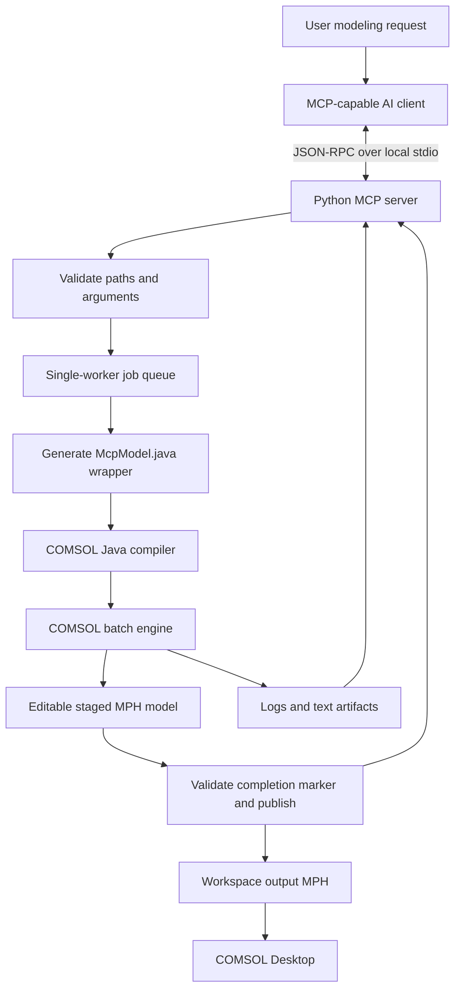
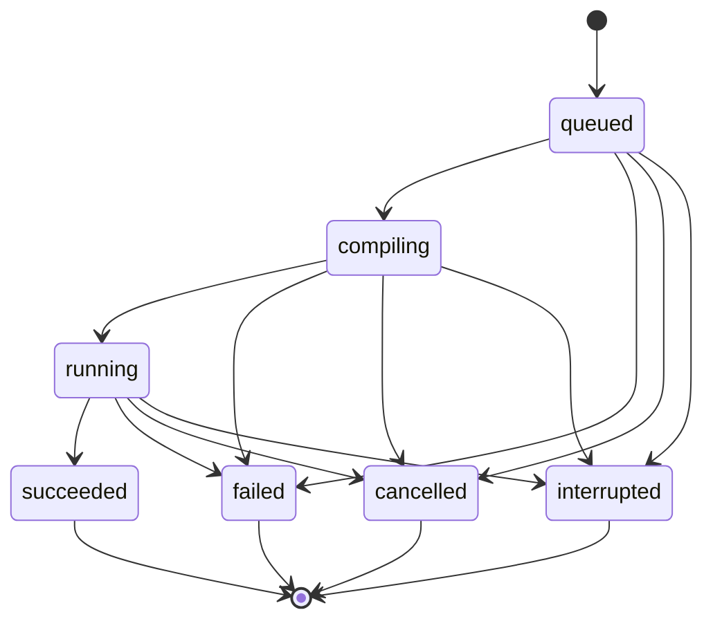

# COMSOL MCP — Editable Native Models

A local Windows MCP server that creates genuine COMSOL `.mph` models with editable geometry features, parameters, materials, physics, meshes, studies, solutions and results. Uses the native COMSOL Java API through `comsolcompile.exe` and `comsolbatch.exe`; MATLAB and MPh are not required.

## What it does

An MCP-capable AI client supplies modeling instructions; this server executes them in a locally installed COMSOL engine and returns job results. The output is a native editable model, not an image, mesh-only interchange file, or imitation MPH format. The bridge supports custom Java API code, so it is not limited to the included examples.

Verified on **Windows, COMSOL 6.2 Build 290, Python 3.12 and MCP SDK 2.3.0**. This is a Windows implementation; Linux and macOS are not supported by the current process launcher and workspace lock. It is an independent integration, not an official COMSOL product.

## Installation

### 1. Prerequisites

- A Windows computer with Python 3.10+ and Git available on PATH.
- A working, licensed COMSOL installation with `comsolcompile.exe` and `comsolbatch.exe` under `Multiphysics/bin/win64`.
- A compatible MCP client, such as Codex, that can launch local stdio servers.
- Appropriate COMSOL module licenses for the physics you want to use.

COMSOL is not bundled. MATLAB, LiveLink for MATLAB, MPh, a separate Java installation, and the COMSOL Compiler add-on for standalone application distribution are not needed by this bridge's model-Java compilation workflow. COMSOL's bundled Java tooling is used.

### 2. Clone and install

```powershell
git clone https://github.com/Irfan-1506/COMSOL_mcp.git
cd COMSOL_mcp
.\setup.ps1
```

The setup script creates a project-local `.venv`, installs the dependency versions in `requirements-lock.txt`, and generates `mcp-config.json` with absolute paths for this checkout. The lock was generated from the verified Python 3.12 Windows environment. Other Python versions are not verified. If PowerShell policy prevents scripts from running, perform the equivalent Python commands allowed by your organization's policy:

```powershell
python -m venv .venv
.\.venv\Scripts\python.exe -m pip install -r requirements-lock.txt
```

Then configure your MCP client manually using the example below. If you move or rename the checkout, rerun setup and update the client registration.

### 3. Connect the MCP client

**Codex:** from the checkout, run:

```powershell
.\connect-codex.ps1
```

This runs `codex mcp add comsol-editable -- <venv-python> <server.py>`. The Codex CLI must be available on PATH. The script refuses to replace an existing `comsol-editable` registration. Restart/reload the client afterward.

**Other stdio MCP clients:** merge the generated `mcp-config.json` into the client's MCP configuration. Do not replace unrelated server entries. A manual example is:

```json
{
  "mcpServers": {
    "comsol": {
      "command": "C:/projects/COMSOL_mcp/.venv/Scripts/python.exe",
      "args": ["C:/projects/COMSOL_mcp/server.py"],
      "env": {
        "COMSOL_HOME": "C:/Program Files/COMSOL/COMSOL62/Multiphysics",
        "COMSOL_MCP_WORKSPACE": "C:/projects/COMSOL_mcp/models",
        "COMSOL_MCP_CORES": "2"
      }
    }
  }
}
```

Replace example paths with your own. The client launches the server automatically. Only one server may own a given workspace. A stdio server launched manually will wait for protocol messages; it does not provide a web page.

### 4. Verify and create a model

Ask the client to call `comsol_status`, retrieve the `block` template, submit it through `create_model`, and poll `job_status`. Installation discovery alone does not verify the license; a successful COMSOL job does.

Example prompts after connection:

> Use COMSOL to create a parameterized 20 × 10 × 5 mm block, build its mesh, and save it as block.mph. Poll the job until finished.

> Open block.mph, change L to 35 mm, rebuild the geometry, and save a separate block_long.mph.

> Create and solve the heat_transfer template and save heated_square.mph. Explain its assumptions.

Open the resulting MPH file in COMSOL Desktop with **File → Open**. Parameters and feature nodes remain editable. Editing geometry or parameters does not automatically update a saved solution: rerun the relevant mesh/study as needed.

## Architecture



The MCP server is the orchestration layer; COMSOL is the modeling and solver engine. The AI client generates or selects Java statements. The server itself contains no LLM, API key, physics solver, or external model-generation service. It performs no automatic mesh-convergence study or engineering validation.

### Components and responsibilities

| Component | Responsibility |
| --- | --- |
| MCP tool layer | Expose typed tool arguments, instructions, templates and job inspection |
| Path validation | Resolve wrapper-managed inputs/outputs within the workspace and preserve existing output files |
| Java wrapper generator | Create/load `Model`, insert trusted statements, save MPH, print a job-specific success marker |
| Single-worker executor | Serialize COMSOL compilation and execution without holding the MCP request open |
| Process runner | Capture stdout/stderr, enforce a deadline, terminate the job process tree on timeout |
| COMSOL compiler | Compile the generated source against the installed COMSOL Java API |
| COMSOL batch engine | Build geometry, run requested operations, solve studies, save models and export artifacts |
| Persistent job directory | Retain source, compiler/batch/process logs, status and exported text |
| Workspace lock | Prevent two server processes from controlling the same queue directory |

### One job, end to end

1. `create_model` or `edit_model` validates the installation, timeout, paths and output name.
2. A UUID job directory and initial `status.json` are created. The request returns a job ID immediately.
3. A single worker takes the job, compiles `McpModel.java`, and checks that the compiler produced a class file.
4. COMSOL batch starts with two cores by default, software rendering, a per-job preference directory and short-lived solver scratch storage.
5. Java creates a new model or loads the input model, executes the supplied statements, saves `result.mph` and prints a unique completion marker.
6. The server verifies the process result, completion marker and nonempty MPH file. COMSOL can return exit code zero even after a model exception, so exit status alone is insufficient.
7. A same-volume Windows rename publishes the complete file under the requested output name. An existing destination causes failure instead of replacement.
8. `job_status` exposes the terminal result and logs. The user can open the MPH in COMSOL Desktop or submit another editing job.

### Job state machine



`interrupted` identifies unfinished status files found when a new server instance acquires the workspace after an abnormal stop. There is no durable queue replay or automatic retry. Normal shutdown requests cancellation of unfinished jobs. Cancellation can race with completion; a job already published successfully remains successful.

## System design decisions

- **Native Java/batch backend:** uses the installed vendor engine and preserves native model features. Each job incurs COMSOL startup overhead, often tens of seconds, even for small edits.
- **Asynchronous job IDs:** solver duration does not become one long MCP tool request. The client polls explicitly; there is no unsolicited progress stream.
- **One worker per workspace:** reduces license contention and process interference. Requests may queue; separate workspaces can run independently but still compete for machine resources and license seats.
- **Files as durable artifacts:** generated source and logs make failures inspectable. No database or always-running COMSOL server is required.
- **Copy-on-edit workflow:** each edit loads the input and saves a new output filename. This preserves the prior file but does not add undo transactions to arbitrary Java statements.
- **Explicit success validation:** incomplete/error models are not exposed as successful outputs, even when COMSOL produces a fallback save.
- **Local trust boundary:** stdio avoids opening a network listener. Arbitrary Java remains trusted code with the local user's privileges; this bridge is not suitable as an unauthenticated multi-user service.

## Repository layout

```text
COMSOL_mcp/
├── server.py                 # MCP tools, Java wrapper and job/process orchestration
├── setup.ps1                 # Virtual environment + generated client configuration
├── connect-codex.ps1         # Optional Codex CLI registration
├── requirements.txt          # Direct SDK dependency
├── requirements-lock.txt     # Verified Windows/Python dependency set
├── examples/*.java.txt       # Geometry, thermal, inspection and export templates
├── tests/test_controls.py    # Host-side process and protocol checks
├── tests/verify_mcp.py        # Licensed real-COMSOL integration verification
├── docs/VALIDATION.md        # Sanitized verification record
└── models/                  # Runtime files; excluded from Git
    ├── your-model.mph
    └── .jobs/<uuid>/         # Source, class, logs, preferences and status
```

Generated virtual environments, machine-specific MCP configuration, verification logs and model workspaces are excluded from version control. The repository contains no COMSOL binaries, license files, credentials or personal absolute paths.

## Tools

| Tool | Purpose |
| --- | --- |
| `comsol_status` | Locate COMSOL and report the model workspace |
| `list_models` | List saved MPH files |
| `get_template` | Retrieve block, heat_transfer, inspect or export_java code |
| `create_model` | Build a new model with Java API statements |
| `edit_model` | Load a model, apply API statements and save a new copy |
| `set_parameters` | Change parameter expressions and optionally rebuild/solve |
| `solve_model` | Run a named study and save its solution |
| `job_status` | Read job state, log tails and artifact names |
| `read_job_artifact` | Read generated Java, CSV, text or logs in pages |
| `cancel_job` | Cancel a queued/running job |

Create/edit tools return immediately with a job ID. Poll `job_status` until `succeeded`, `failed`, `cancelled` or `interrupted`. Only `succeeded` confirms that a native model has been saved. Jobs run sequentially to limit resource and license use. The timeout starts when a queued job begins execution.

## Modeling API

`java_body` contains statements acting on the provided `Model model` variable, without a class, imports, main method or return statement. The server handles loading, naming and saving. For example:

```java
model.param().set("L", "25[mm]");
model.component("comp1").geom("geom1").run();
model.component("comp1").mesh("mesh1").run();
model.study("std1").run();
```

Use the `inspect` template with `edit_model` to print parameters and feature tags to the job logs, preserving a separate output copy. Use the `export_java` template to produce `ExportedModel.java`, then read it with `read_job_artifact`. This exposes the editable model's API construction/history for further changes. COMSOL's Record Code and Save As → Model File for Java are useful sources of version-correct API calls.

To edit an existing external MPH file, copy it into `models/` or choose its parent folder as `COMSOL_MCP_WORKSPACE`. Inputs and outputs must be inside that workspace. Existing output files are never overwritten by the wrapper. Use versioned names.

## Settings

Optional MCP server environment variables:

| Variable | Default |
| --- | --- |
| `COMSOL_HOME` | Auto-detect `C:/Program Files/COMSOL/COMSOL*/Multiphysics` |
| `COMSOL_MCP_WORKSPACE` | `models` next to server.py |
| `COMSOL_MCP_CORES` | `2` |

Set COMSOL_HOME to the **Multiphysics** folder, not `bin/win64`. Model paths can be relative to the workspace or absolute inside it. Keep each independently running MCP server on a separate workspace.

## Execution and limitations

This is a trusted local code execution bridge, not a Java sandbox. Java model code has filesystem access through a separate per-job `comsol.prefs` containing `security.external.filepermission=full`. This enables native load/save/export and does not modify normal COMSOL Desktop preferences. Wrapper path checks do not restrict arbitrary paths embedded in Java code. Use trusted code and a local stdio connection.

Physics interfaces and imports require the appropriate COMSOL modules/licenses. The bridge cannot make an unlicensed module available or guarantee correctness of arbitrary simulations. The heat example is a uniform 2D square with isotropic conductivity, constant properties, uniform volumetric heating and all edges fixed at ambient temperature; it is a demonstration, not a calibrated engineering model.

Jobs keep generated source, logs and status in `models/.jobs/<job-id>/`. Solver scratch/recovery files use a short operating-system temporary directory to avoid Windows native path-length errors; that temporary directory is cleaned after the batch process ends. Failed jobs do not publish their partially built models. Server restarts mark unfinished jobs interrupted; they do not resume them. Abrupt process termination may leave COMSOL child processes running; check Windows Task Manager before resubmitting an interrupted job. Job artifacts are retained for diagnosis and can consume disk space. COMSOL batch may also save its own fallback MPH artifact inside the job directory.

## Verification

Run the real COMSOL integration checks from this directory:

```powershell
.\.venv\Scripts\python.exe tests\verify_mcp.py
```

This launches a real stdio MCP client/server, creates a meshed block, changes its length, reopens it and checks the parameter and feature tree, exports Java, creates/solves/reloads a thermal model, checks its maximum temperature, rejects invalid paths and overwrites, and confirms COMSOL runtime errors are reported as failures. Each run uses a fresh model subfolder. Successful runs write `verification.json`. Stop any MCP client using this workspace before running the checks.

`tests/test_controls.py` additionally checks workspace path confinement, real subprocess timeout termination, queued cancellation and the packaged stdio server. Run it with the same Python executable; it uses an isolated temporary workspace and needs no COMSOL license.

See [the validation record](docs/VALIDATION.md) for the tested environment and observed results. The integration test's temperature range is a regression sanity check, not an independent analytical or mesh-convergence validation.

## Troubleshooting

| Symptom | What to check |
| --- | --- |
| COMSOL not found | Set `COMSOL_HOME` to the installation's `Multiphysics` folder |
| License or unknown-physics error | Read batch logs; confirm the installed version and required license modules |
| Output already exists | Choose a new output filename |
| Another server owns the workspace | Close the other client or assign a separate workspace |
| Compiler produced no class file | Inspect `compile.log` and verify Java API syntax for your COMSOL version |
| Model code did not complete | Inspect `batch.log` and `process.log`; do not trust exit code zero alone |
| Timeout | Check mesh/model size; raise `timeout_seconds` up to 86400 if appropriate |
| Native file/path-length error | Keep the checkout and workspace paths reasonably short; solver scratch already uses a short OS temporary directory |
| Filesystem security error | Verify the batch job received its per-job preferences; organizational restrictions may prohibit filesystem access |
| Client has no tools after setup | Reload the client and check its MCP server logs and absolute executable paths |
| Parameters changed but solution looks old | Rebuild the mesh as needed and rerun the study using `solve_model` or Java |

## Extending the server

Add reusable modeling bodies under `examples/` and explicitly include their names in `get_template`. For a higher-level tool, validate its arguments and generate Java statements using `java_string` for user-provided strings, then call `submit`. Keep compilation and solver execution in the single-worker queue. Add targeted checks for new behavior and run the real integration suite for changes to model compilation, saving or solving. Do not expand wrapper path checks into claims of sandboxing: Java execution is intentionally general.

The current server has no GUI automation, remote HTTP deployment, authentication service, distributed queue, automatic retry, automatic parameter optimization or general-purpose geometry/physics validation. These are extension areas, not existing features.

## References

- [COMSOL API overview](https://www.comsol.com/support/learning-center/article/overview-of-the-comsol-api-107912)
- [COMSOL command-line documentation](https://doc.comsol.com/6.3/doc/com.comsol.help.comsol/comsol_ref_running.38.31.html)
- [COMSOL staff guidance on isolated filesystem preferences](https://www.comsol.com/forum/thread/348282/exporting-results-from-the-command-line-with-no-access-to-desktop-app-modifying-security-preference-file-system-access)
- [Official MCP Python SDK](https://github.com/modelcontextprotocol/python-sdk)
